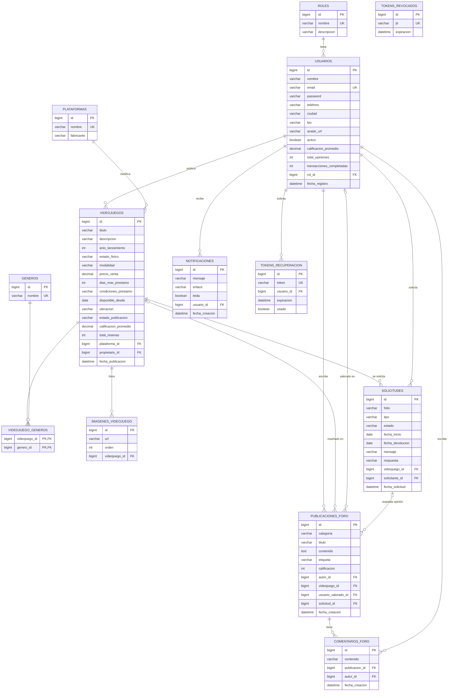
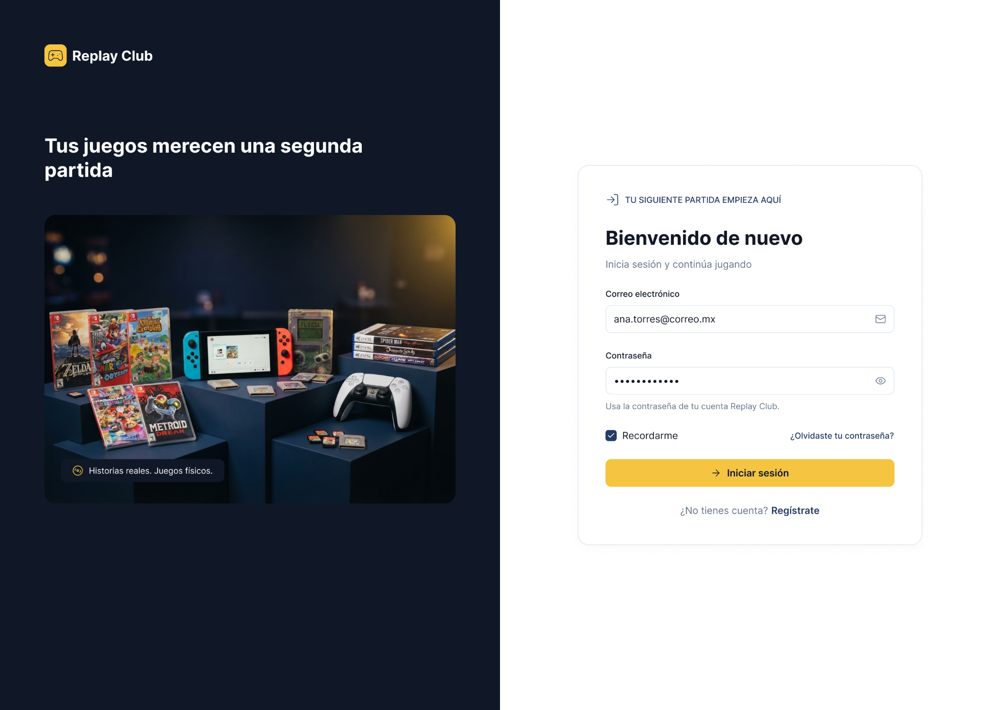
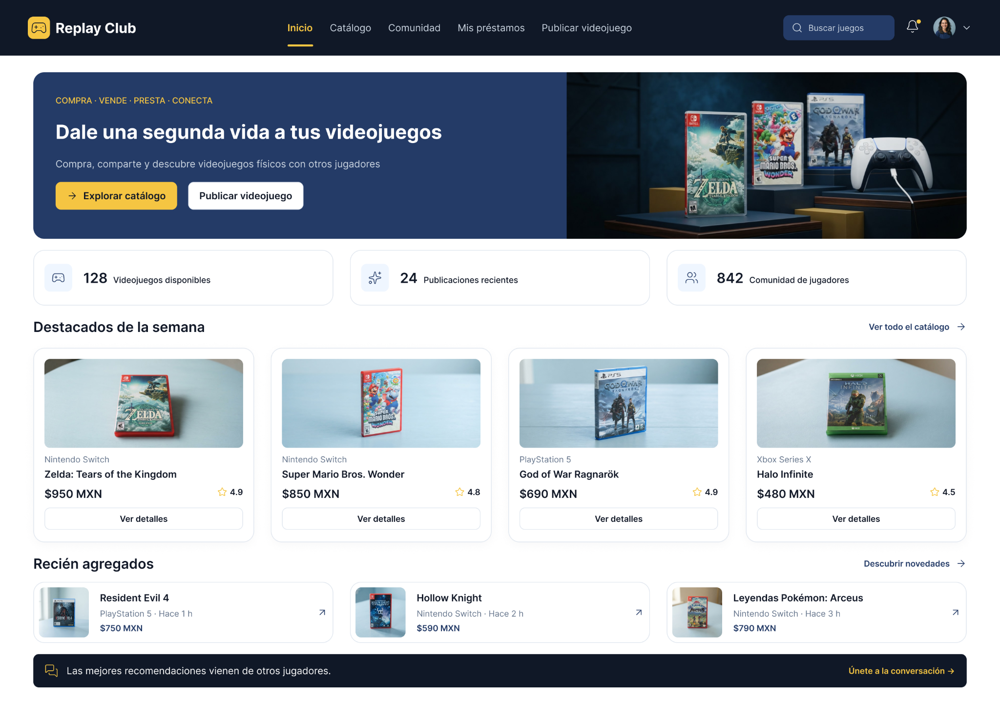
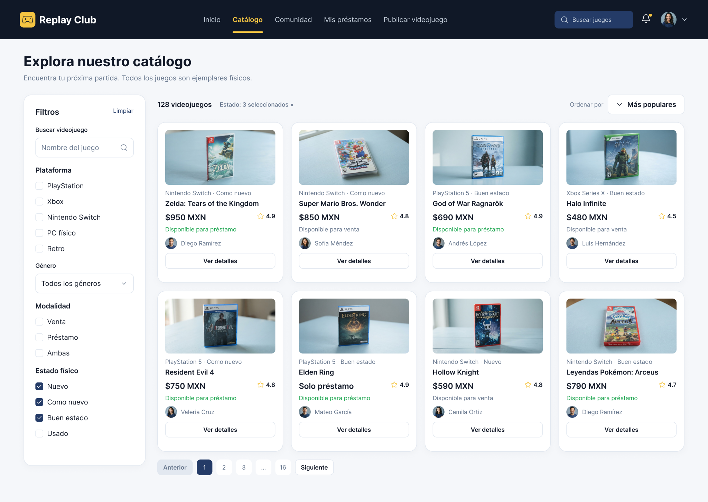
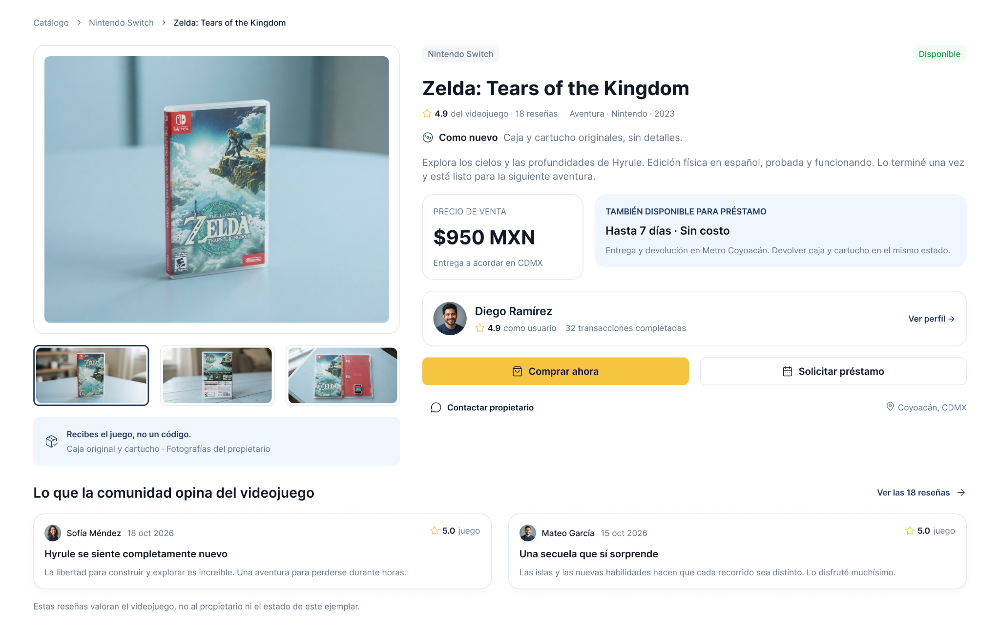
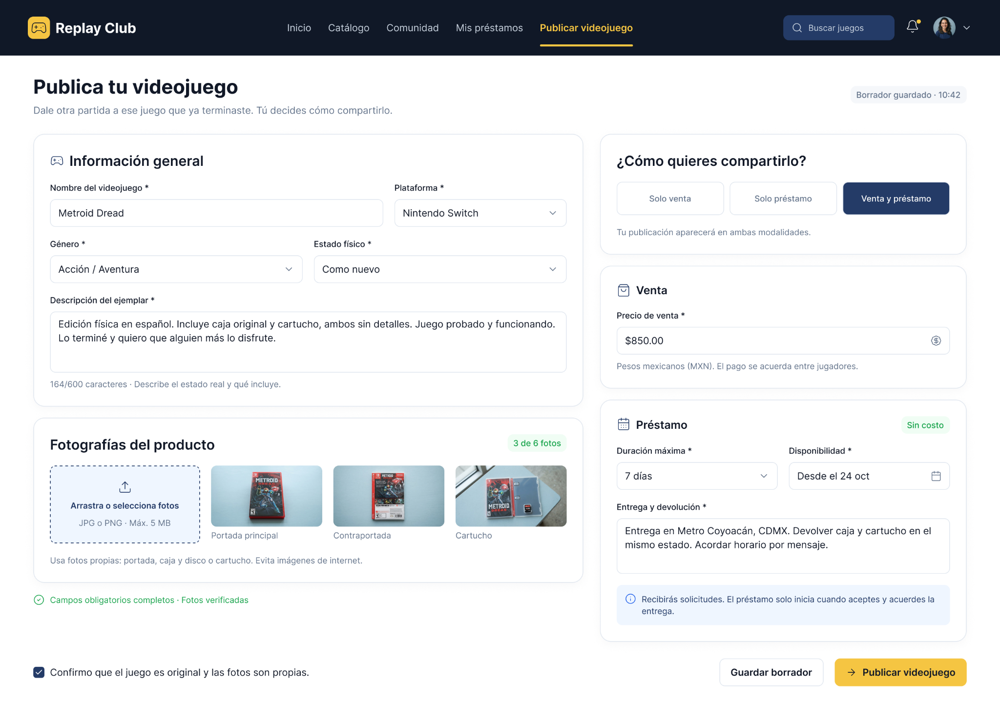
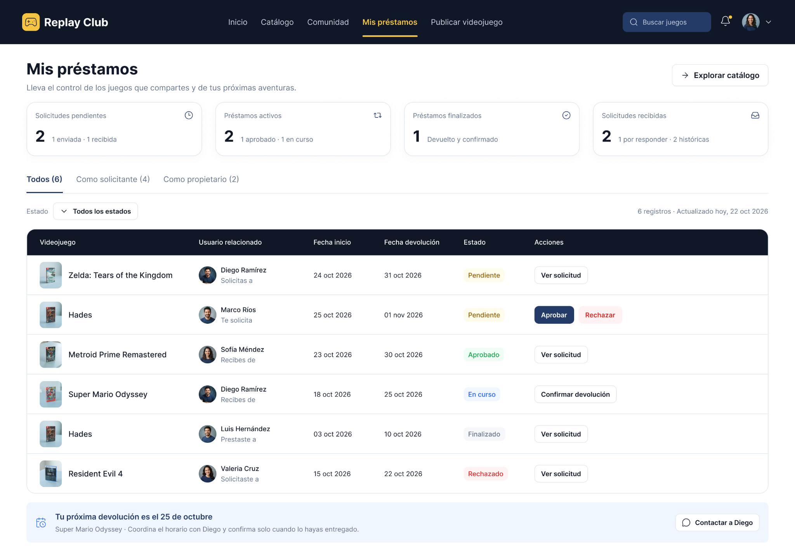
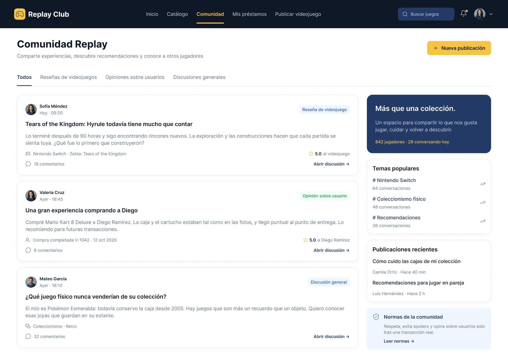
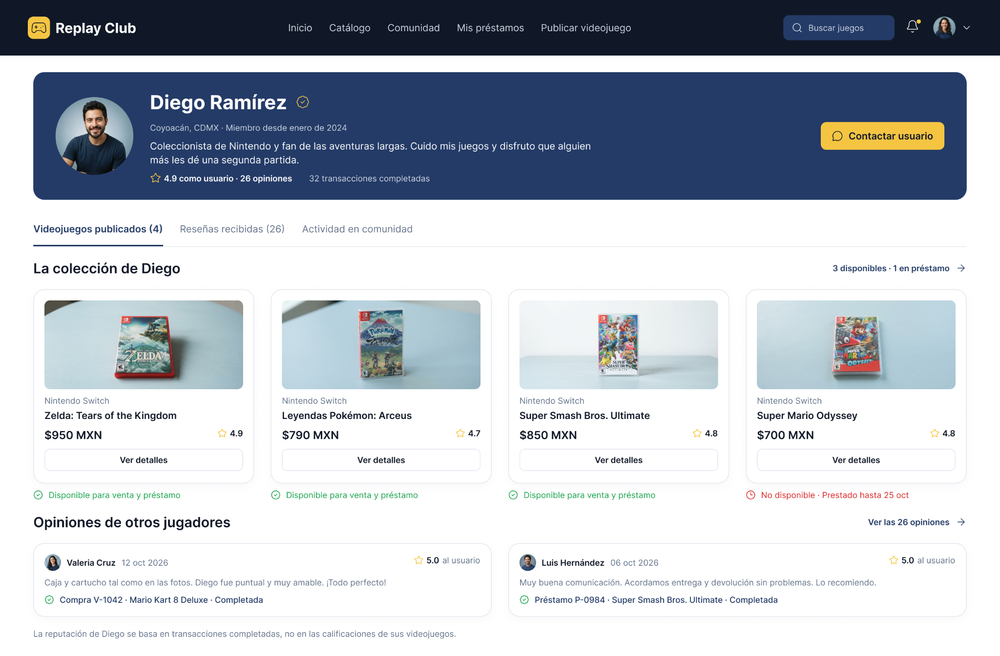

<p align="center"></p>

# Replay Club

**Tus juegos merecen una segunda partida.** Replay Club es una plataforma web donde jugadores **rentan (piden prestados)**,
**prestan** y **venden** videojuegos **físicos** entre ellos, con una comunidad para reseñar juegos y calificar a otros
usuarios tras cada transacción.

**Problemática que resuelve:** los videojuegos físicos son caros y, una vez terminados, se quedan en un estante. Replay Club
conecta a quien tiene un juego sin usar con quien quiere jugarlo, con un flujo de préstamo controlado (solicitud → aprobación
→ entrega → devolución), avisos por correo/SMS/WhatsApp y reputación basada en transacciones reales.

**Equipo 11 — Programación Web**

- Gómez Vasquez Fredy Azarel
- Gonzalez Santiago Francisco Javier

| Recurso | Enlace |
|---|---|
| Aplicación desplegada (HTTPS) | `https://TU-DOMINIO` ← *actualizar* |
| URL base de la API | `https://TU-DOMINIO/api` ← *actualizar* |
| Prototipo navegable en Figma | `PEGAR_LINK_DE_FIGMA` ← *actualizar* |
| Tablero de GitHub Projects (público) | `PEGAR_LINK_DE_GITHUB_PROJECTS` ← *actualizar* |
| Repositorio | https://github.com/FranciscoJ619/t3_act8_eq11 |

---

## Tecnologías

| Capa | Tecnología |
|---|---|
| Backend | Java 21, Spring Boot 4.1 (Web MVC, Data JPA/Hibernate, Security, Validation, Mail), JWT (jjwt 0.12) |
| Base de datos | MySQL 8/9, migraciones con **Flyway** |
| Frontend | React 19, Vite 7, React Router 7, Axios, Lucide (iconos) |
| Comunicación | Postfix + JavaMailSender (correo), API REST de Twilio (SMS y WhatsApp) |
| Pruebas de API | Bruno (colección en `/bruno`) |
| Despliegue | VPS Ubuntu, Nginx, systemd, Let's Encrypt (Certbot) |
| Diseño | Figma (prototipo, paleta, logo) |

## Estructura del repositorio

```
t3_act8_eq11/
├── backend/                Spring Boot (API REST)
│   └── src/main/
│       ├── java/com/replayclub/api/
│       │   ├── config/        SecurityFilterChain, CORS, archivos estáticos
│       │   ├── security/      JWT, filtro, UserDetailsService
│       │   ├── domain/        Entidades JPA y enums
│       │   ├── repository/    Spring Data JPA (EntityGraph contra N+1)
│       │   ├── dto/           DTOs de entrada (Bean Validation) y salida
│       │   ├── validation/    Validadores personalizados
│       │   ├── service/       Lógica de negocio, correo, Twilio
│       │   ├── controller/    @RestController
│       │   └── exception/     @RestControllerAdvice (400/401/403/404/422/500)
│       └── resources/
│           ├── db/migration/  V1__esquema_inicial.sql, V2__datos_prueba.sql (Flyway)
│           └── application.properties.example
├── frontend/               React + Vite
├── bruno/                  Colección de pruebas de la API
├── database/               replay_club_respaldo.sql (respaldo completo)
├── deploy/                 Nginx, systemd y guía de despliegue (Postfix, SPF, DKIM, Certbot)
└── docs/figma/             Capturas del prototipo
```

## Roles de usuario

| Rol | Qué puede hacer |
|---|---|
| **ADMIN** | Acceso total: CRUD de usuarios (crear, editar rol, activar/desactivar, eliminar), plataformas, géneros, videojuegos, solicitudes y moderación del foro. Estadísticas generales. |
| **MODERADOR** (rol "otro") | Modera el catálogo (oculta/reactiva publicaciones) y la comunidad (retira publicaciones y comentarios). No publica ni renta juegos. |
| **JUGADOR** (cliente) | Solo sus propios datos: publica sus juegos, solicita préstamos/compras, aprueba o rechaza las solicitudes que recibe, reseña juegos y opina sobre usuarios tras una transacción. |

La restricción se aplica en el backend con `SecurityFilterChain` (por ruta) y `@PreAuthorize` (por método), y en React
con rutas protegidas (`RequireRole`) y menús que se muestran u ocultan según el rol.

## Credenciales de prueba

| Rol | Correo | Contraseña |
|---|---|---|
| **Administrador (evaluación)** | `admin@replayclub.mx` | `Admin123!` |
| Moderador | `moderador@replayclub.mx` | `Moder123!` |
| Moderador | `moderador2@replayclub.mx` | `Moder123!` |
| Jugador | `ana.torres@correo.mx` | `Jugador123!` |
| Jugador | `diego.ramirez@correo.mx` | `Jugador123!` |
| Jugador | cualquier otro `@correo.mx` de los datos de prueba | `Jugador123!` |

Las contraseñas se guardan con **BCrypt**. Requisitos (validados en React bajo el input y en el backend con Bean Validation):
mínimo 8 caracteres, una mayúscula, un número y un carácter especial.

## Diagrama Entidad-Relación

12 tablas. La relación **N:M** es `videojuegos` ↔ `generos` (tabla intermedia `videojuego_generos`).



**Datos de prueba** (Flyway `V2__datos_prueba.sql`): 3 roles, 15 usuarios, 10 plataformas, 12 géneros, 24 videojuegos,
39 relaciones videojuego-género, 15 solicitudes en todos los estados, 16 publicaciones del foro, 20 comentarios y
12 notificaciones. Respaldo completo: [`database/replay_club_respaldo.sql`](database/replay_club_respaldo.sql).

## Instalación local

**Requisitos:** Java 21, Node 20+, MySQL 8 o superior.

### 1. Base de datos
```sql
CREATE DATABASE replay_club CHARACTER SET utf8mb4 COLLATE utf8mb4_unicode_ci;
CREATE USER 'replayclub'@'localhost' IDENTIFIED BY 'tu_password';
GRANT ALL PRIVILEGES ON replay_club.* TO 'replayclub'@'localhost';
```
No hay que crear tablas a mano: **Flyway** ejecuta las migraciones al arrancar el backend.

### 2. Backend
```bash
cd backend
cp src/main/resources/application.properties.example src/main/resources/application.properties
# Edita application.properties: usuario/contraseña de MySQL y app.jwt.secret (openssl rand -base64 48)
./mvnw spring-boot:run          # Windows: mvnw.cmd spring-boot:run
```
La API queda en `http://localhost:8010/api`. Con `app.mail.enabled=false` y `app.twilio.enabled=false` los correos/SMS/WhatsApp
se escriben en el log en lugar de enviarse (útil para desarrollo).

### 3. Frontend
```bash
cd frontend
npm install
npm run dev                      # http://localhost:5173 (proxy /api -> :8010)
```

### 4. Producción
`./mvnw -DskipTests package` genera `backend/target/replay-club-api.jar` y `npm run build` genera `frontend/dist`.
La guía paso a paso del VPS (MySQL, systemd, Nginx, Certbot, Postfix con SPF/DKIM y Twilio) está en
[`deploy/DESPLIEGUE.md`](deploy/DESPLIEGUE.md).

## API REST (resumen)

Base: `/api`. Todas las rutas, salvo login/registro/recuperación, exigen `Authorization: Bearer <token>`.

| Método | Ruta | Rol | Descripción |
|---|---|---|---|
| POST | `/auth/login` · `/auth/registro` | público | Devuelve el JWT y el usuario |
| POST | `/auth/logout` | autenticado | Revoca el token actual (lista negra por `jti`) |
| POST | `/auth/olvide-password` · `/auth/restablecer-password` | público | Recuperación por correo |
| GET/PUT | `/usuarios/me` · PUT `/usuarios/me/password` | autenticado | Mi cuenta |
| GET | `/usuarios/{id}` · POST `/usuarios/{id}/contactar` | autenticado | Perfil público / mensaje (correo + WhatsApp) |
| GET | `/videojuegos?q&plataformaIds&generoId&modalidad&estadosFisicos&orden&page&size` | autenticado | Catálogo filtrado y paginado en el servidor |
| GET | `/videojuegos/mios` · `/videojuegos/{id}` | autenticado | Mis publicaciones / detalle |
| POST/PUT/DELETE | `/videojuegos[/{id}]` | JUGADOR, ADMIN | Publicar, editar, eliminar (solo el propietario o admin) |
| GET | `/solicitudes?rol&estado&tipo&page` · `/solicitudes/resumen` | autenticado | Mis préstamos y compras |
| POST | `/solicitudes` | JUGADOR, ADMIN | Solicitar préstamo o compra |
| PATCH | `/solicitudes/{id}/aprobar · rechazar · entregar · confirmar-devolucion · cancelar` | participante | Flujo de la solicitud |
| GET/POST/DELETE | `/foro/publicaciones` · `/foro/publicaciones/{id}/comentarios` · `/foro/comentarios/{id}` | autenticado | Comunidad |
| GET | `/notificaciones` · PATCH `/notificaciones/{id}/leida` | autenticado | Campana del navbar |
| POST | `/archivos` | autenticado | Subir imagen (JPG/PNG/WEBP, 5 MB) |
| GET/POST/PUT/DELETE | `/plataformas` · `/generos` | lectura: todos · escritura: ADMIN | Catálogos |
| * | `/admin/usuarios` · `/admin/solicitudes` · `/admin/estadisticas` | ADMIN | Administración |
| GET/PATCH | `/admin/videojuegos` · `/admin/videojuegos/{id}/estado` | ADMIN, MODERADOR | Moderación |

Errores en JSON con el código correcto:
```json
{ "timestamp": "...", "status": 400, "error": "Bad Request", "message": "Hay campos con errores, revisa el formulario",
  "path": "/api/auth/registro", "errores": { "password": "La contraseña debe tener al menos 8 caracteres, ..." } }
```

## Pruebas con Bruno

Abre la carpeta [`bruno/`](bruno) en Bruno, selecciona el entorno **Local** (o **Produccion**) y ejecuta en orden:

1. `01 Autenticacion` — login de jugador, admin y moderador; guarda los tokens en variables de entorno.
2. `02`–`05` — peticiones protegidas que envían el token en el header `Authorization`.
3. `06 Errores a proposito` — 401 sin token, 401 credenciales inválidas, 403 acceso denegado, 400 datos inválidos,
   404 recurso inexistente, 422 regla de negocio y logout que invalida el token.

## Diseño (Figma)

Prototipo navegable con las 8 pantallas principales: inicio de sesión, inicio, catálogo, detalle del videojuego,
publicar, mis préstamos, comunidad y perfil. Capturas en [`docs/figma/`](docs/figma).

**Paleta (regla 60-30-10) y justificación con teoría del color:**

| Uso | Color | Justificación |
|---|---|---|
| 60 % neutro | `#F5F7FA` fondo, `#FFFFFF` tarjetas | Neutros fríos que dan aire y legibilidad; dejan que las portadas sean protagonistas. |
| 30 % secundario | `#101827` azul nocturno, `#243B67` azul retro | El azul transmite **confianza y seguridad**, clave cuando prestas algo de valor a un desconocido; el tono oscuro evoca la noche de los videoclubes. |
| 10 % acento | `#F5C542` amarillo arcade | Complementario cálido del azul: máximo contraste para llamadas a la acción (botones principales, pestaña activa) y nostalgia de las fichas y marquesinas arcade. |
| Estados | `#16A34A` disponible, `#DC2626` no disponible, `#2563EB` información | Convenciones semánticas universales (semáforo) para entender el estado de un juego de un vistazo. |

Tipografía **Inter**, iconografía **Lucide**, radios de 8 px (botones/inputs) y 16 px (tarjetas), espaciado en múltiplos de 8.
El logotipo (control de videojuego sobre fondo amarillo arcade) es original del equipo: [`frontend/public/logo.svg`](frontend/public/logo.svg).

<p>
 
 
 
 
</p>

## Seguridad

- Variables sensibles solo en `application.properties` (ignorado por Git); en el repo está `application.properties.example`.
- Contraseñas con BCrypt; JWT firmado (HS384) con expiración y revocación en logout.
- Validaciones en frontend (bajo cada input, en tiempo real y al enviar) y backend (Bean Validation en DTOs).
- Las entidades JPA nunca se exponen: todas las respuestas son DTOs.
- Problema N+1 controlado con `@EntityGraph` en consultas paginadas y `@BatchSize` en colecciones (`generos`, `imagenes`).
